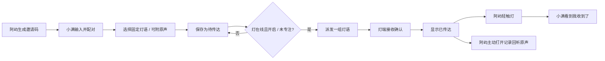

> 2026-10-30 更新：以下为首版比赛计划。当前账号已统一，不再选择固定角色；任一方均可邀请和收发，每人可选绑定自己的一台玩偶，旧配对兼容。比赛最低真机验收仍为两部手机与一台玩偶；当前数据结构和行为以《正式版与展示版.md》《硬件API.md》为准。

# MVP 0：先把一束关心，完整送到

> 历史首版计划，保留比赛分工参考。2026-10-29 修订以《正式版与展示版.md》和《硬件API.md》为准：已增加个人呼吸记录、自由休息、双向回应和独立登录；灯语单轮结束后淡出，不等待触摸阻塞后续消息；不向亲友展示自动已传达时间。

依据用户指定 PDF 第 2 页 A. 情感光、第 3 页交互优先级与 MVP 0，限定单台玩偶灯、异步灯语、触摸回执、专注模式、主动语音回听和单方解绑。用户负责 APP，硬件同学只需围绕明确协议联调。

## 最小可交付功能

P0 必须完成：两个角色、一个配对、一台接收灯；四种意图选择与灯语预览；可靠入队、灯端接收确认、触摸回执；专注/熄灯屏蔽派发；离线重试；单方解绑撤销访问；屏幕模拟灯保底演示。

P1 在 P0 稳定后完成：原声文件上传和接收方主动回听。浏览器录音作为便利入口，不作为手机 HTTP 演示的依赖。本版两者代码均已实现。

不纳入两天范围：成对灯、语音回复与通话、共同回忆、压力/呼吸/姿态感知、摄像头、健康数据共享、情绪诊断、社区、复杂 AI、推送通知、原生安装包、云端正式账号系统。专注状态只给本人控制，亲友看不到实时工作状态。

## 用户流程

任何一方可在“亲友连接”单独解绑 → 配对停用 → 撤销设备指令 → 清除配对消息和已发送原声 → 必须生成新邀请码才能重新连接。

## 四种灯语（文档定义）

| intent | 文案 | 表达 | pattern |
|---|---|---|---|
| miss | 我想你了 | 缓慢、柔和的明暗起伏 | slow_breathe |
| meal | 记得吃饭 | 暖橙与乳白低亮度交织 | warm_crossfade |
| rest | 别熬太晚 | 短暂、缓慢地收暗再恢复 | dim_restore |
| cheer | 加油 / 拍拍你 | 两次柔和、富有活力的亮度跃动 | double_pulse |

周期、RGB 色值、18% 亮度上限为本次工程初值，不是 PDF 的定量指标，也不是已验证的 LED 光照剂量。硬件同学现场调低至舒适、不眩目；本次不声称节律效果。

## 消息与队列规则

1. 发送成功只证明 SQLite 已保存；状态为 queued（待传达）。
2. 设备 35 秒内有心跳、允许灯光、未专注、配对有效时，才可取得指令。
3. 最旧消息先传达；相邻且意图相同的待传达消息合成一个灯语批次。不同意图不强行合并，原声分别保留。
4. offered 指令反复查询得到同一 id；设备成功接受灯语后上报 delivered 才更新“已传达”。HTTP 200 查询本身不表示亮过灯。
5. 一个批次在触摸前保持为当前心意，不叠加下一批，也不发声音/弹窗/催促。触摸后全批次变 received，再排下一批。
6. 开专注或熄灯会撤销尚未确认的 offered 指令，旧确认返回 409；已接收灯语暂停光效，解除边界后可继续，不自动视为收到。
7. 每个发送用 clientId 去重，每次触摸用 eventId + commandId 去重。一个触摸只确认屏幕或硬件当前展示的批次。
8. 不加入自然间隙识别：本版用接收方手动解除专注作为明确时机。

## 数据模型（SQLite）

| 表 | 核心字段 | 用途 |
|---|---|---|
| users | id, name, account, password, role | 固定演示角色，密码哈希 |
| sessions | token, user_id, expires | 用户会话，token 哈希存储 |
| pairs | id, sender_id, receiver_id, active, created | 一对一配对 |
| invites | code, owner_id, expires, used | 10 分钟、一次性邀请码 |
| devices | id, owner_id, key_hash, focus, power, last_seen | 单台灯及本人控制 |
| messages | id, pair_id, sender_id, receiver_id, intent, note, audio_id, status, created, delivered, received, client_id | 个人心意与时间戳 |
| commands | id, device_id, pair_id, intent, message_ids, status, created, delivered, received | 重试稳定的灯语批次 |
| touches | event_id, command_id, created | 触摸幂等 |
| uploads | id, owner_id, path, mime, size, created | 非公开音频资源 |

users → pairs → messages；receiver → devices → commands → messages；commands → touches；messages → uploads。内部时间统一 Unix 毫秒，界面按访问设备本地时间显示。

## 10 月 31 日—11 月 1 日两天安排

以下是建议分工节奏，不代表赛事已确认的报到/提交时间。

| 时段 | 用户负责 APP | 硬件同学 / 共同产出 |
|---|---|---|
| 10/31 上午 | 启动本项目、走双端流程，冻结四种 intent 与状态 | 确认单台灯可联网、LED 与触摸可独立工作 |
| 10/31 下午 | 对接硬件心跳/查询/确认，修正联调反馈 | 真灯按模式低亮度呈现；触摸上报 commandId |
| 10/31 晚上 | 保存可演示版本，验证专注/断线/解绑 | 完整跑通一束关心 → 真灯 → 回执；保留模拟器后备 |
| 11/1 上午 | 补语音上传与手机实际访问，处理失败状态 | 验证熄灯优先，避免同时连模拟灯与真灯 |
| 11/1 下午 | 冻结功能、录备用演示、整理启动及接口说明 | 演练 3 分钟故事：专注不打扰，休息时收到 |
| 提交前 | 按实际比赛截止时间留出打包和网络缓冲 | 若硬件不稳，明确使用模拟灯，不假称真机完成 |

现场最低验收：双端可打开；四种意图可发；专注时不派发；解除后按顺序接收；触摸只确认当前批次；原声由用户主动播放；任意一方解绑立即生效；服务重启不丢消息。
